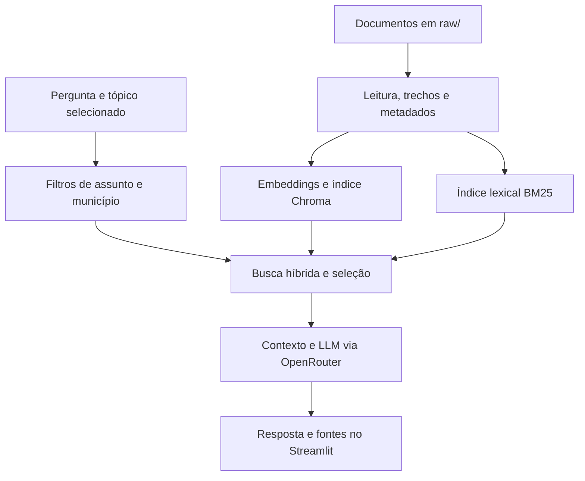

ChatbotRS
ARANDUEDU · Assistente para consulta de dados educacionais e ICMS Educacional do Rio Grande do Sul.

Projeto acadêmico desenvolvido com Python, Streamlit e uma arquitetura RAG (Retrieval-Augmented Generation). O chatbot consulta uma base documental, recupera trechos relevantes e utiliza uma LLM pelo OpenRouter para responder com fontes.

O foco do projeto é a relação entre SAERS, IMERS, PRE, IPM e a repartição municipal do ICMS, incluindo a comparação de indicadores educacionais dos municípios gaúchos.

Repositório: projects-yuri/ChatbotRS.
Funcionalidades
- Consultar conceitos, metodologia e legislação de referência da educação e do ICMS Educacional no RS.
- Comparar indicadores de municípios e a evolução do IMERS entre 2024 e 2025.
- Combinar busca por palavras com busca vetorial, usando filtros de assunto, tipo de conteúdo e município.
- Exibir as fontes e os trechos utilizados na resposta.
- Manter histórico da conversa, seleção de tópicos, preferências visuais e interface em português e inglês.
- Apresentar a aba Detalhamento do Projeto, com explicação dos arquivos, fluxo do chatbot e configurações carregadas.
Base de conhecimento
Os documentos ficam diretamente na pasta raw/. A base unificada compacta reúne conceitos, legislação e um recorte dos 497 municípios do RS.
Conteúdo	Recorte disponível
SAERS	Conceitos e relação com os indicadores municipais
IMERS	Valores municipais de 2024 e 2025 e variação em pontos
Componentes do IMERS	IQA, IQI, IQF e IA de 2025
PRE	Participação municipal de 2025, em porcentagem, conforme o IMERSVis
ICMS Educacional e IPM	Conceitos, regras de referência e relação com a distribuição de recursos
Educação básica	Contexto complementar de financiamento e responsabilidades, incluindo Fundeb e LDB

Os dados municipais foram selecionados do arquivo oficial do IMERSVis, mantendo poucos campos para reduzir o tamanho da base. O ano da avaliação é identificado nos registros e não deve ser confundido com o ano de publicação ou o exercício de distribuição de recursos.

Fontes de referência: DEE/IMERS, IMERSVis e os documentos oficiais citados dentro da base.
Como funciona

1. Preparação: o leitor extrai e limpa o texto, separa seções e cria trechos com metadados de fonte, assunto e município.
2. Busca: o BM25 encontra termos e números exatos; o Chroma recupera trechos por similaridade vetorial. O foco selecionado ajuda a interpretar perguntas curtas.
3. Seleção: os candidatos são combinados por posição com Reciprocal Rank Fusion (RRF). A busca remove duplicações e reserva espaço para os municípios comparados, dentro do limite de contexto.
4. Geração: a pergunta e os trechos selecionados são enviados à LLM. A interface apresenta a resposta e suas fontes.
O RAG não treina novamente a LLM com os documentos. A atualização da base exige atualizar sua leitura e seus índices.
Tecnologias
Tecnologia	Função
Python	Implementação do projeto
Streamlit	Interface, histórico, preferências e detalhamento do projeto
ChromaDB	Armazenamento e consulta dos vetores
Sentence Transformers	Geração de embeddings multilíngues
BM25	Recuperação lexical em memória
LangChain / ChatOpenAI	Integração da chamada ao modelo de linguagem
OpenRouter	API de acesso à LLM
PyPDF	Extração de texto de PDFs
python-dotenv	Carregamento da configuração local

Arquivos do projeto
Arquivo ou pasta	Responsabilidade
app.py	Interface do chatbot, histórico, fontes, preparação inicial e aba Detalhamento do Projeto
src/settings.py	Diretórios, modelos, modo de busca e parâmetros de indexação e recuperação
src/ingestion.py	Leitura de PDF, TXT, MD e CSV; limpeza, divisão em trechos, metadados e indexação
src/lightweight.py	Busca BM25, normalização e identificação de municípios por nome completo ou IBGE
src/retrieval_policy.py	Classificação de temas, interpretação do foco e filtros comuns às buscas
src/search.py	Recuperação híbrida, fusão RRF, deduplicação e seleção dos trechos
src/rag.py	Montagem do contexto, instruções à LLM, chamada ao OpenRouter e retorno das fontes
src/municipalities_rs.json	Nomes e códigos IBGE dos 497 municípios; não contém os indicadores numéricos
src/__init__.py	Identificação do pacote Python
raw/	Documentos e indicadores consultados pelo chatbot
requirements.txt	Dependências instaladas no ambiente padrão
requirements-core.txt	Dependências comuns para execução sem embeddings
requirements-vector.txt	Dependências comuns acrescidas de Chroma, Sentence Transformers e Torch
tests/	Testes de leitura, busca, municípios, filtros e interface
tools/integrate_compact_data.py	Seleção dos indicadores do CSV oficial e atualização do Markdown
tools/organize_base.py	Organização dos blocos de legislação, rateio, avaliação e municípios
.env.example	Exemplo de configuração local
.gitignore	Arquivos locais que não devem entrar no versionamento
.devcontainer/devcontainer.json	Ambiente de desenvolvimento em contêiner
README.md	Apresentação e instruções gerais do projeto

Os scripts Python devem conservar a extensão .py, e o catálogo municipal deve se chamar municipalities_rs.json. Um arquivo compactado como src.zip não substitui os módulos da pasta src/ na execução do aplicativo.
Executar localmente
1. Clonar e preparar o ambiente
git clone https://github.com/projects-yuri/ChatbotRS.git
cd ChatbotRS
python -m venv .venv
Ative o ambiente no Windows PowerShell:
.venv\Scripts\Activate.ps1
Ou no Linux/macOS:
source .venv/bin/activate
Instale as dependências:
pip install -r requirements.txt
2. Configurar o OpenRouter
Crie um arquivo .env na raiz. Exemplo com os padrões do código:
OPENROUTER_API_KEY=SUA_CHAVE_AQUI
OPENROUTER_MODEL=z-ai/glm-5.2:free
OPENROUTER_BASE_URL=https://openrouter.ai/api/v1

RETRIEVAL_MODE=hybrid
EMBEDDING_MODEL=sentence-transformers/paraphrase-multilingual-MiniLM-L12-v2

CHUNK_SIZE=900
CHUNK_OVERLAP=180
TOP_K=5
CANDIDATE_K=12
MAX_CONTEXT_CHUNKS=5
INDEX_BATCH_SIZE=48
Substitua a chave pelo seu valor e use OPENROUTER_MODEL para escolher o modelo de resposta. Mantenha a chave e o .env fora do GitHub.
3. Iniciar o aplicativo
streamlit run app.py
O app prepara a base ao iniciar. No modo híbrido, a primeira execução também carrega o modelo de embeddings e cria o índice vetorial.
Configuração no Streamlit Cloud
Configure o repositório projects-yuri/ChatbotRS, a branch de implantação e o arquivo principal app.py. Em Settings → Secrets, use o formato TOML:
OPENROUTER_API_KEY = "SUA_CHAVE_AQUI"
OPENROUTER_MODEL = "z-ai/glm-5.2:free"
RETRIEVAL_MODE = "hybrid"
EMBEDDING_MODEL = "sentence-transformers/paraphrase-multilingual-MiniLM-L12-v2"

CHUNK_SIZE = 900
CHUNK_OVERLAP = 180
TOP_K = 5
CANDIDATE_K = 12
MAX_CONTEXT_CHUNKS = 5
INDEX_BATCH_SIZE = 48
Reinicie o aplicativo depois de alterar a configuração. Variáveis já definidas no ambiente têm prioridade sobre os arquivos de configuração. A aba Detalhamento do Projeto → Configuração mostra os valores carregados e somente o estado de configuração da chave da API.
Principais parâmetros
Parâmetro	Padrão do código	O que controla
RETRIEVAL_MODE	hybrid	Modo de recuperação
CHUNK_SIZE	900	Limite de caracteres por trecho, incluindo seu cabeçalho
CHUNK_OVERLAP	180	Sobreposição máxima, ajustada ao espaço disponível no trecho
TOP_K	5	Quantidade desejada de trechos finais
CANDIDATE_K	12	Piso de candidatos antes da seleção
MAX_CONTEXT_CHUNKS	5	Teto de trechos enviados ao modelo
INDEX_BATCH_SIZE	48	Tamanho dos lotes de indexação
EMBEDDING_MODEL	sentence-transformers/paraphrase-multilingual-MiniLM-L12-v2	Modelo que representa os textos em vetores
OPENROUTER_MODEL	z-ai/glm-5.2:free	Modelo que redige as respostas
COLLECTION_NAME	pi5_documentos	Nome da coleção no Chroma
CHROMA_DIR	Pasta temporária gravável	Diretório do índice vetorial
INDEX_VERSION	Definida em src/settings.py	Identificação usada na reconstrução do índice

O código calcula o orçamento de recuperação assim:
limite_final = min(TOP_K, MAX_CONTEXT_CHUNKS)
candidatos = max(CANDIDATE_K, limite_final * 6)
Com os padrões acima, são até 5 trechos finais e um piso de 30 candidatos na etapa de busca. O Chroma limita o pedido ao número de registros disponíveis; filtros podem reduzir os resultados. Para ampliar o contexto final, ajuste tanto TOP_K quanto MAX_CONTEXT_CHUNKS.
Modos de busca
Modo	Comportamento
hybrid	Combina Chroma e BM25, com filtros e fusão por posição
vector	Valor de compatibilidade que também utiliza a recuperação híbrida
lexical	Utiliza BM25 e os filtros, sem carregar embeddings nem Chroma

Para uma instalação local leve, instale requirements-core.txt e configure RETRIEVAL_MODE=lexical. No Streamlit Cloud, para também deixar de instalar as dependências vetoriais, use apenas -r requirements-core.txt no requirements.txt da raiz.
Atualizar a base
São aceitos arquivos .md, .txt, .pdf e .csv, colocados diretamente em raw/. PDFs precisam conter texto extraível para o leitor atual.

Prefira preservar os cabeçalhos Markdown e identificar cada município com nome e IBGE, por exemplo:
### Município: Porto Alegre — IBGE 4314902
O leitor também reconhece títulos municipais e títulos conhecidos da base quando os marcadores # foram perdidos durante uma cópia. Quando a base canônica Base_Unificada_Educacao_RS.md está presente, cópias numeradas do mesmo nome são ignoradas para evitar conteúdo duplicado.

O app verifica mudanças na base e nos parâmetros de indexação ao preparar os documentos. Para solicitar a reconstrução manual:
python -m src.ingestion --reset
Para reproduzir o recorte municipal a partir do CSV oficial:
python tools/integrate_compact_data.py caminho/imers_pre_2022_2025.csv
O script atualiza os resumos e organiza as seções. O CSV completo não precisa permanecer no deploy. Os scripts de manutenção precisam conservar os nomes e extensões indicados na tabela de arquivos.
Exemplos de perguntas
- Quais leis regulamentam o ICMS Educacional no RS?
- Como a PRE se relaciona com o IMERS e com o porte municipal?
- Compare o IMERS e a PRE de Porto Alegre e Santa Maria em 2025. A cidade com maior IMERS também tem maior PRE?
- Entre Porto Alegre e Caxias do Sul, qual apresentou a maior melhora no IMERS de 2024 para 2025?
- Qual componente apresentou o menor valor em Pelotas em 2025: IQA, IQI ou IQF?
Limites de interpretação
- A PRE é uma participação percentual no rateio educacional: não é uma nota escolar, o IPM total ou um valor em reais.
- A base compacta não contém pagamentos mensais, repasses municipais em reais, dados por escola ou o histórico municipal completo anterior a 2024.
- A recuperação de alguns trechos não equivale ao cálculo de um ranking estadual completo. Comparações precisam conter os trechos de todas as cidades solicitadas.
- Variações nos indicadores não demonstram, sozinhas, as causas da melhora ou da queda.
- As respostas dependem da cobertura documental, da recuperação e da LLM. Confira os trechos apresentados nas fontes.
Testes e validação
A suíte atualizada do pacote inclui testes de documentos vazios, limites dos trechos, reconhecimento de municípios, leitura sem marcadores Markdown, filtros, fusão híbrida e interface.

Execute a suíte com RETRIEVAL_MODE=lexical definido no ambiente para verificar as regressões sem carregar embeddings reais.
python -m unittest discover -s tests -v
A descoberta automática exige nomes test_*.py. Arquivos legados de teste podem conter expectativas da base extensa; a suíte do pacote atualizado acompanha o recorte compacto.

Na última validação local do pacote, 36 testes passaram. Os testes de interface utilizaram Streamlit 1.40.2 e AppTest, em modo lexical, incluindo navegação, filtros, idioma e preservação do histórico/foco. Os testes do ramo vetorial usaram retornos simulados do Chroma. Essa execução não validou embeddings reais, a disponibilidade do modelo no OpenRouter ou o deploy em produção.
